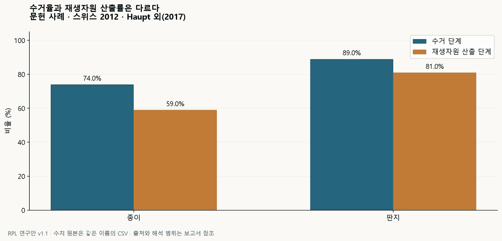
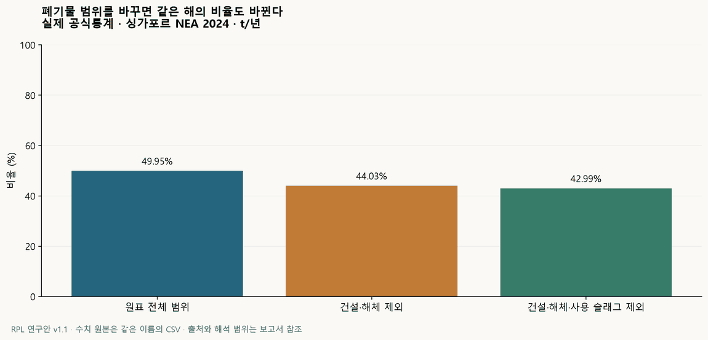
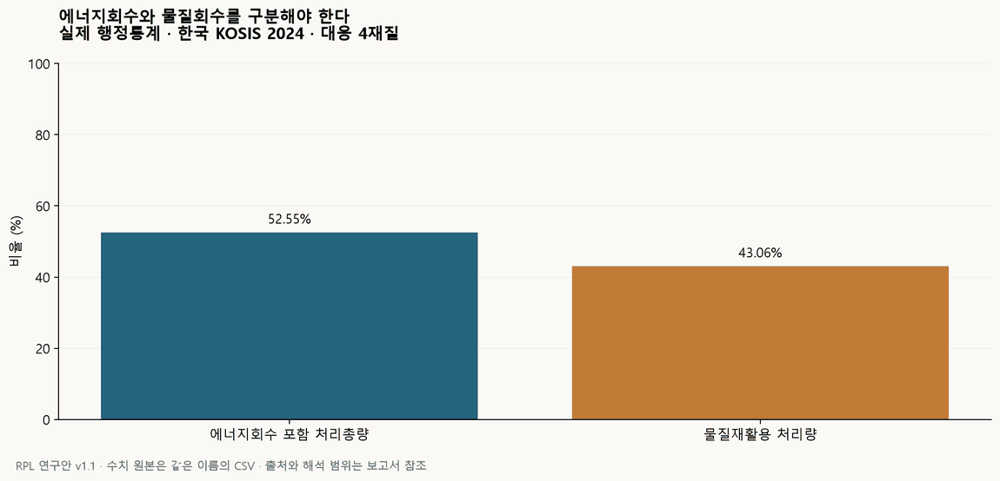
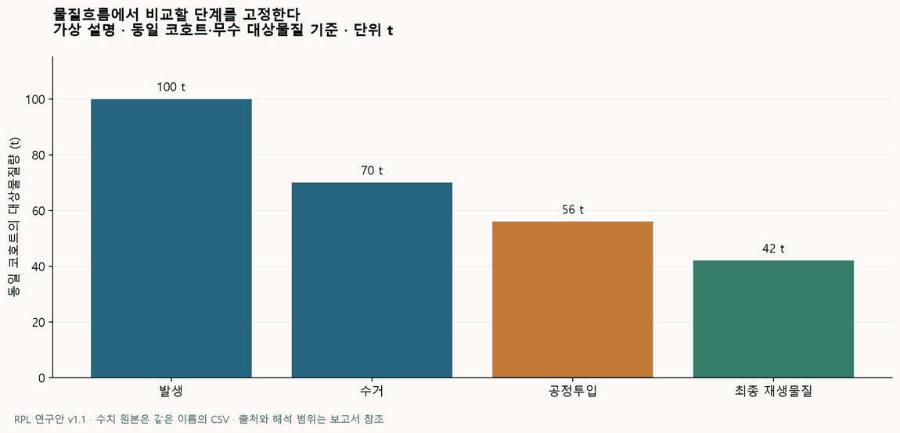
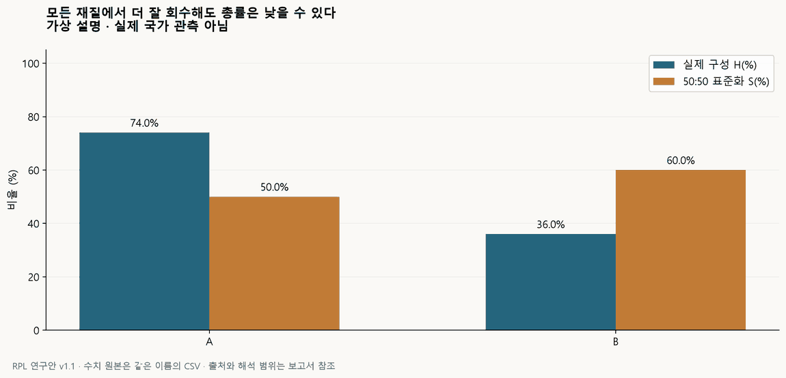
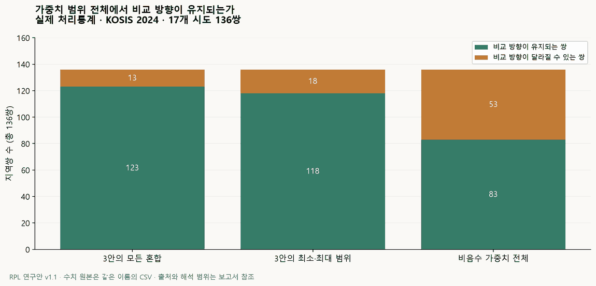
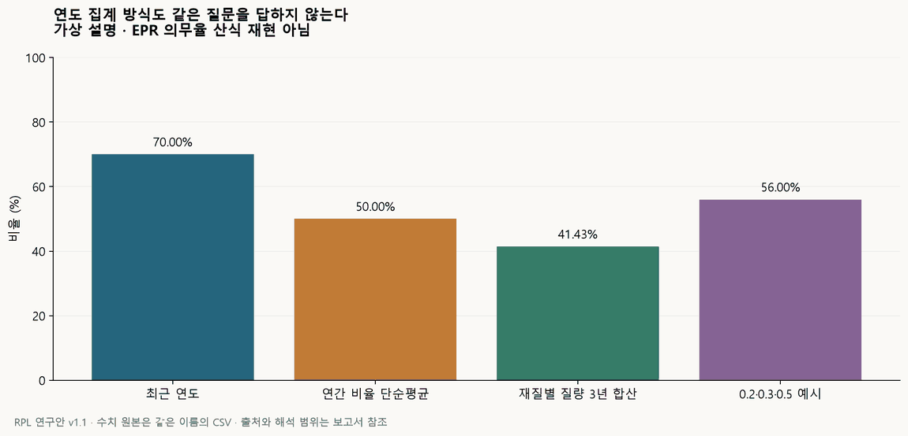
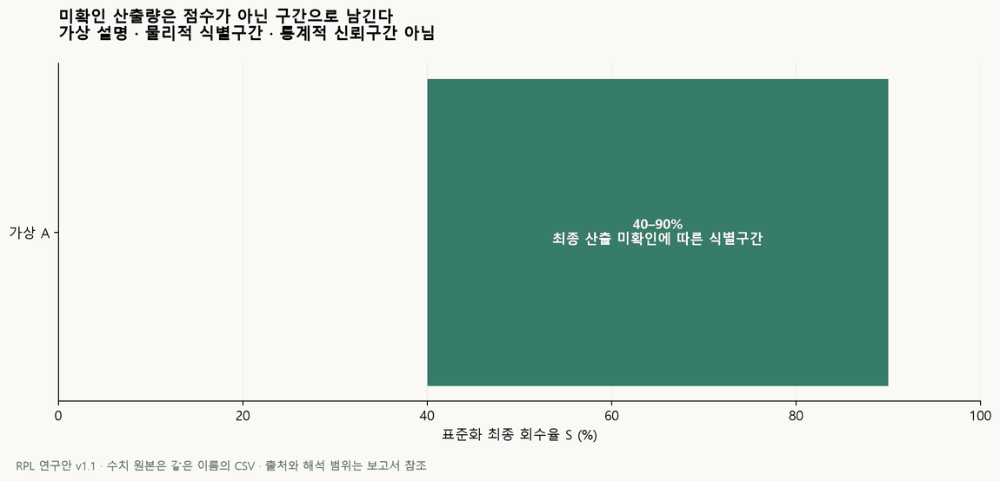
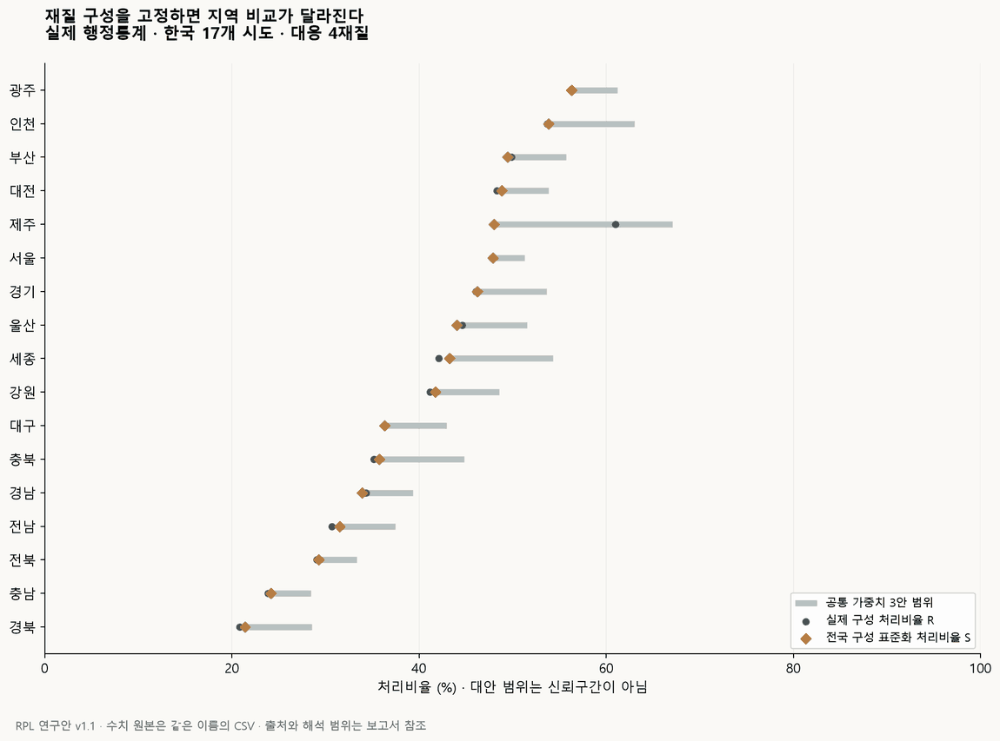
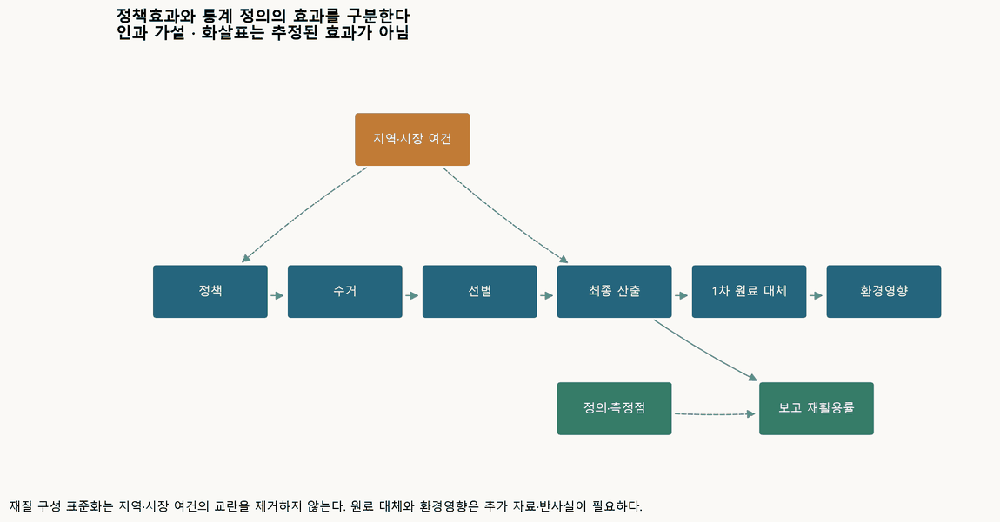

# 재활용률의 국제 비교를 위한 측정 기준과 지표 개발

RPL 연구안 v1 · 2026-11-16 · 문헌·공식 기준 검토와 기존 실데이터를 이용한 측정 타당성 연구

## 초록

재활용률은 재활용된 양을 발생량으로 나눈 값이지만, 무엇을 폐기물에 넣는지와 어느 공정에서 양을 재는지가 다르면 같은 이름의 숫자가 다른 현상을 측정한다. 본 연구는 국가 순위를 먼저 만드는 대신, **폐기물 범위·측정점·원산지·기간·질량 기준을 일치시키는 규약**을 제안한다. 이를 통과한 자료에서 실제 구성에 따른 최종 물질회수율 H와 공통 재질 구성에 따른 표준화 최종 물질회수율 S를 함께 산출한다. 발생량·수거율·공정 수율·품질·환경편익은 서로 다른 질문을 답하는 보조 지표로 둔다.

국가별 기준과 지표 연구를 포함한 22개 근거 항목을 목적 중심으로 검토했다. 기존 저장소의 한국 2024년 4재질 자료와 싱가포르 2024년 재질별 통계로 정의 선택의 영향을 계산하고, 스위스 물질흐름 연구의 수거·재생자원 단계 차이를 재도식화한다. 최종 산출량이 없는 한국 자료에서는 기존 R/S **처리비율**을 계산할 수 있지만 새 H/S의 관측값은 식별되지 않는다. 이 구분은 결측을 숨긴 국가 순위를 방지한다. 본 연구가 제공하는 근거는 측정 규약의 논리적·경험적 필요성이며 특정 정책의 인과효과를 입증한 결과는 아니다.

## 1. 연구 질문과 검증할 명제

연구 질문은 “폐기물의 종류와 집계 방식이 달라도 재활용률을 어떻게 공정하게 비교할 수 있는가?”다. ‘효율성’은 우선 **발생한 대상 물질 중 재생원료로 되돌린 비율**로 한정한다. 금전 투입 대비 성과인 경제적 효율성, 환경 순편익, 폐기물 예방 성과는 별도 평가한다.

검증 명제는 다음과 같다.

1. 같은 물질흐름도 측정점·범위가 달라지면 보고 재활용률이 달라진다.
2. 재질별 회수율이 같아도 재질 구성만 다르면 총 재활용률이 달라진다.
3. 공통 재질 가중치를 고정하면 이 구성 차이의 산술적 영향은 제거된다.
4. 그 결과도 시설·소득·정책·통계 품질의 차이까지 제거하지는 못한다.
5. 최종 회수율이 높다는 사실만으로 환경편익 또는 정책효과가 크다고 결론 낼 수 없다.

1·2는 실제 자료와 구성 사례를 구분해 확인한다. 3은 대수적으로 증명한다. 4·5는 인과모형과 선행연구에 근거해 해석의 경계를 설정한다. 새 지표가 기존 지표보다 환경영향을 더 잘 예측한다는 주장은 후속 검증 대상이다.

2-3절은 기존 재활용률이 왜 달라지는지 확인한다. 4절은 비교할 양과 계산 규칙을 정하고, 5-6절은 행정통계에서의 적용과 산식의 성질을 확인한다. 7~8절은 정책과 환경 성과를 검증하려면 어떤 추가 자료가 필요한지 설명한다.

## 2. 선행연구 조사 방법과 근거의 강도

2026-11-16에 공식 기관·학술지·저자기관 자료를 목적 표집했다. 검색축은 `recycling rate calculation point`, `municipal waste comparability`, `recycling process losses`, `circular economy indicators`, `substitution`, `재활용의무율 가중치`다. 정의 연구, 물질흐름 사례, 지표 종합검토, 공식 통계 메타데이터, 환경·인과 평가 방법을 포함했다. 출처 불명 국가 순위, 측정점을 알 수 없는 비율, 근거 없는 국가 공통 수율은 정량 입력에서 제외했다.

이는 PRISMA 방식의 전수 체계적 문헌고찰이나 메타분석이 아니다. 검색결과 전체 건수·중복제거·탈락 논문 목록을 확보하지 않았으므로 그런 형식의 수치를 제시하지 않는다. 22개는 서로 독립적인 실험 수가 아니라 학술·제도·통계·방법 근거 항목 수다. Graedel 논문과 UNEP 금속 보고서는 겹치는 연구 기반이다.

[기계 판독 근거 목록](../data/indicator_sources.json)은 각 항목의 URL, 확인 절, 검증 수준, 채택 내용과 한계를 담는다. 일부는 초록 또는 공식 검색 색인의 해당 조문만 확인했다. EU 2019/1004 전체 PDF 접근은 검증 화면에 막혔으므로 전체 원문을 정독했다고 표기하지 않는다. 동적 메타데이터 항목의 연도는 열람 버전, 통계 항목은 분석 기준연도이며 일괄 출판연도가 아니다.

### 2.1 재활용이라는 이름 아래 다른 분모가 있다

[Graedel 외(2011)](https://pubs.usgs.gov/publication/70034205)는 폐기 후 회수율, 재생원료 투입비중, 스크랩 구성비를 구분한다. 제품 생산에 재생원료가 얼마나 들어갔는지와 발생 폐기물이 얼마나 회수됐는지는 분모부터 다르다. [UNEP 금속 보고서(2011)](https://wedocs.unep.org/handle/20.500.11822/8702)도 이 구분을 뒷받침한다. 이 연구에서 폐기물 관리 성과의 분모는 출고량이나 신제품 생산량이 아니라 대상 폐기물 발생량으로 고정한다.

### 2.2 수거가 끝났다고 재생원료가 만들어진 것은 아니다

[Haupt·Vadenbo·Hellweg(2017)](https://onlinelibrary.wiley.com/doi/10.1111/jiec.12506)의 2012년 스위스 물질흐름 연구는 수거 단계와 재생자원 산출 단계를 구분한다. 같은 연구 경계에서 종이 수거율 74%와 재활용률 59%, 판지 89%와 81%가 보고된다. 그림 1은 이 두 쌍만 재도식화한다. 수출을 포함한 문헌 모형의 물질흐름 결과이며 현재 국가 실적이나 한국 수율의 대체값이 아니다. 공식 통계의 별도 97%와는 분모가 다를 수 있어 같은 쌍에 섞지 않는다.



**그림 1 · 문헌 사례.** 같은 재질에서 수거와 최종 산출 사이의 차이가 종이 15%p, 판지 8%p다. 제안 지표의 분자에 어느 단계의 양을 넣을지 정해야 하는 근거다.

### 2.3 순환성과 환경 지속가능성은 별개의 평가 대상이다

[Zaman·Lehmann(2013)](https://www.sciencedirect.com/science/article/abs/pii/S095965261200635X)의 Zero Waste Index는 매립 회피를 넘어 원료 대체 잠재량을 평가한다. [Vadenbo 외(2017)](https://onlinelibrary.wiley.com/doi/full/10.1111/jiec.12519)는 대체에 관한 가정의 공개를 강조한다. [Haupt·Hellweg(2019)](https://www.sciencedirect.com/science/article/pii/S2665972719300054)는 순환 지표와 환경 평가의 연결 문제를 다룬다. [Zink·Geyer(2017)](https://onlinelibrary.wiley.com/doi/abs/10.1111/jiec.12545)는 불완전한 대체와 가격 변화로 편익이 줄 수 있음을 논의한다. 따라서 본 지표의 분자에 검증되지 않은 ‘환경점수’를 곱하지 않는다.

### 2.4 모든 질문을 한 점수로 답하려 하면 가중치 문제가 커진다

[Moraga 외(2019)](https://backoffice.biblio.ugent.be/download/8617340/8617343)는 물질순환과 영향 평가의 범위를 구분하고 지표 집합의 사용을 제안한다. [Saidani 외(2019)](https://www.sciencedirect.com/science/article/pii/S0959652618330221)는 55개 지표 집합을 목적에 맞게 분류한다. [OECD/EU/JRC(2008)](https://www.oecd.org/en/publications/handbook-on-constructing-composite-indicators-methodology-and-user-guide_9789264043466-en.html)에 따라 가중치 근거와 대안에 대한 민감도를 공개한다. 본 연구의 S는 경제·사회·환경 점수를 합친 종합등급이 아니라 동일 단위의 재질별 회수율을 공통 구성으로 집계한 값이다.

## 3. 국가·제도별 측정 기준 대조

| 출처 | 분모와 범위 | 분자·측정점 | 국제 비교 시 확인할 점 |
|---|---|---|---|
| [한국 KOSIS 생활폐기물](https://kosis.kr/statHtml/statHtml.do?orgId=106&tblId=DT_106N_29_2020005) | 생활폐기물 원표. 현재 분석은 대응 4재질 부분집합 | 처리경로별 물량. 최종 재생원료량과 다름 | 생활폐기물 전체와 4재질을 구분하고 에너지회수 처리경로를 분리 |
| [한국 EPR 별표 5](https://www.law.go.kr/LSW/flDownload.do?bylClsCd=110201&flSeq=157059077&gubun=) | 대상 제품·포장재 출고량 기반, 품목별 조정 있음 | 의무율 설정을 위한 실적 평균·목표 반영 | 국가 폐기물 발생량 분모의 실적률과 구분 |
| [EU 폐기물 기본지침](https://eur-lex.europa.eu/legal-content/EN/TXT/?uri=CELEX%3A02008L0098-20251016), [2019/1004](https://eur-lex.europa.eu/eli/dec_impl/2019/1004) | Municipal waste. 산업 생산·건설해체 등 제외 | 재질별 법정 계산지점. 반려물 제외 규정 | ‘최종 제품 산출량’과 같다고 단정할 수 없음. 보고계열·계산방법 확인 |
| [OECD municipal waste](https://www.oecd.org/en/data/indicators/municipal-waste.html) | 가정과 유사 사업장 등, 하수·건설해체 제외 | 국가 보고 처리자료 | 민간 수거·유사 사업장 포함 범위의 차이 확인 |
| [미국 EPA](https://www.epa.gov/facts-and-figures-about-materials-waste-and-recycling/national-overview-facts-and-figures-materials) | MSW. 건설해체·슬러지·기타 비유해 산업폐기물 제외 | 재활용·퇴비화 등 경로별 추정량, 2018년 기준 | Short ton, 오래된 기준연도, 음식물 추정방법 변경 |
| [싱가포르 NEA](https://www.nea.gov.sg/our-services/waste-management/waste-statistics-and-overall-recycling) | 국내·비국내 부문. 건설·해체 등을 포함 | 폭넓은 보고 재활용 경로, 목재·조경 연료 활용 포함 | 전체률을 다른 국가의 municipal 물질회수율과 직접 비교할 수 없음 |
| [영국 Defra](https://www.gov.uk/government/statistics/uk-waste-data/uk-statistics-on-waste) | Waste from households, municipal, total waste가 별도 | 계열별 재활용·퇴비화 등, 방법 변경 주석 | 잉글랜드와 UK, 회계연도와 역년, 바닥재 금속 포함 등을 확인 |
| [UNEP SDG 12.5.1](https://sdgs.unep.org/article/indicator-1251) | 발생량과 재활용량의 귀속을 맞추는 접근 | 수입·수출 조정, 유기물 경로 포함 | 수출 목적 물량과 검증된 최종 산출 귀속량의 차이 확인 |



**그림 2 · 싱가포르 NEA 2024 공식통계로 재계산.** 전체가 49.95%, 건설·해체 제외 시 44.03%, 건설·해체와 사용 슬래그 제외 시 42.99%다. 각 범주의 발생량과 보고 재활용량을 함께 빼서 집계 범위만 바꿀 때의 차이를 보여준다. [NEA 원표](https://www.nea.gov.sg/our-services/waste-management/waste-statistics-and-overall-recycling)



**그림 3 · 한국 KOSIS 2024 행정통계.** 대응 4재질의 발생량을 공통 분모로 쓰면 에너지회수를 포함한 처리비율은 52.55%, 물질재활용 처리비율은 43.06%다. 분자의 처리경로 범위가 만드는 차이를 보여준다. [KOSIS 생활폐기물 원표](https://kosis.kr/statHtml/statHtml.do?orgId=106&tblId=DT_106N_29_2020005)

### 3.1 한국의 0.2·0.3·0.5 가중치에 대한 정정

이 가중치는 모든 국가 재활용 실적을 평활하는 한국의 보편 산식이 아니다. 위 시행령 별표 5는 **EPR 대상 제품·포장재의 연차 재활용의무율 산정**에 쓰는 실적 평균을 규정한다. 일반적인 경우 의무율 산정연도를 t라 할 때 가장 최근 참조 실적은 t−2이고, t−2·t−3·t−4에 각각 0.5·0.3·0.2를 부여한다. 이 평균에 장기 목표 반영과 조정 요소가 더해진다. 실적이 부족한 때의 예외도 있다. 이 규칙을 단순히 t·t−1·t−2의 국가 재활용률 가중평균이라고 설명하면 적용 대상과 시차를 모두 혼동한다.

국제 비교의 본값은 같은 역년·같은 정의의 관측률로 제안한다. 3년 안정화 지표는 별도 명칭과 기간으로 공개한다. 다른 나라가 모두 같은 유형의 연도 가중치를 쓴다는 전제는 채택하지 않는다.

## 4. 제안: 경계를 먼저 맞추는 H/S 지표 체계

### 4.1 비교 규약 v1

국가·지역 i, 발생연도 t, 재질 m에 대해 다음을 먼저 확인한다.

- **범위:** Municipal waste 중 공통으로 대응 가능한 건식 재질 바스켓. 시범은 종이·판지, 플라스틱, 금속, 유리 4범주다. 한국 원표 대응 그룹과 국제 분류의 대응표가 감사되기 전 국제 적용은 보류한다. 4재질 부분집합은 전체 국가 재활용률로 부르지 않는다.
- **분모 G:** 국내에서 발생한 대상 재질 자체의 질량. 재생원료 수요량·출고량·시설 총반입량을 쓰지 않는다. 무수 기준의 대상 물질 환산량을 사용해 수분·오염물·첨가제로 인한 차이를 줄인다. 수분·물질 구성 측정이 없으면 습윤 처리통계를 자동 변환하지 않는다.
- **분자 F:** 같은 발생연도·원산지의 폐기물에서 최종적으로 얻은, 규격을 충족해 원료로 이용 가능한 **재생물질 자체**의 질량. 수거량·압축 선별품 반출만으로 최종 인정을 하지 않는다. 오염물, 공정 잔재, 외부 첨가물, 연료·에너지회수·되메우기를 제외한다. 직접 재사용·유기물 순환은 별도 모듈로 보고한다.
- **원산지:** 국내 발생분의 국내 최종 회수량과 국외 최종 회수량을 더한다. 수입 폐기물에서 만들어진 원료는 국내 분자에 넣지 않는다. 수출 신고량 전부를 재생량으로 보지 않는다. 추적되지 않은 수출은 미확인 구간으로 남긴다.
- **기간:** 발생연도 코호트를 추적한다. 전년도 재고를 올해 처리한 양과 올해 발생량을 그대로 나누지 않는다. 추적기간·미처리 재고·개정일을 공개한다. 3년 합산도 이 조건을 자동 해결하지 않는다.
- **중복:** 중간시설 간 이동·재선별을 반복 합산하지 않는다. 소각 바닥재에서 회수한 금속을 넣으려면 원래 대상 금속의 질량·원산지·최종 공정까지 한 번만 귀속한다. 바닥재 전체 중량은 금속 재생량이 아니다.

최종 산출 기준은 EU 계산지점을 그대로 복제한 법정 산식이 아니라, 선별 이후 실제 물질 손실도 드러내려는 **연구용 추가 규약**이다. 법정 목표 달성 판정을 대체하지 않는다. 이 규약은 요구 자료가 많고 발생 코호트 확정까지 시간이 걸린다. 비교 가능성을 높이는 대신 자료 가용성과 시의성이 낮아지는 비용을 명시한다.

### 4.2 산식과 지표 이름

재질별 최종 회수율은 `h_itm = F_itm / G_itm`이다. H와 S를 다음과 같이 정의한다.

```text
a_itm = G_itm / Σ_m G_itm
H_it = 100 × Σ_m F_itm / Σ_m G_itm = 100 × Σ_m a_itm h_itm
S_it(w*) = 100 × Σ_m w*_m h_itm
Σ_m w*_m = 1,  w*_m > 0
```

H는 실제로 발생한 바스켓의 몇 %를 최종 회수했는지를 답한다. S는 “모든 국가가 같은 재질 구성 w*를 가졌다면 관측된 재질별 회수율로 얼마가 회수되는가?”라는 표준화 질문을 답한다. S는 실제 국가 총물량 비율이 아니라 **구성 표준화 비교값**이다. 두 값을 함께 보아 실제 성과와 구성 효과를 구분한다.

별도로 `Y_itm = F_itm / I_itm`을 공정 수율로 둔다. I는 같은 원산지·발생 코호트의 재활용 공정 투입량이다. 높은 Y와 낮은 수거율이 함께 있으면 전체 회수 H는 낮을 수 있다. I의 경계를 특정하지 않은 ‘공정 효율 90%’를 국가 전체 회수율로 사용하면 안 된다.

```text
F/G = (C/G) × (I/C) × (F/I)
      수거율 × 선별 후 공정투입 비율 × 최종 공정수율
```

이 항등식은 C·I·F가 동일 코호트·물질 기준이고 누락 경로 없이 연결될 때 성립한다. 경로가 여러 개면 경로별 최종 산출을 합산하고 재순환 경로를 제거한다. 이것은 물질흐름의 회계 관계다. 수거율을 정책으로 1% 높였을 때 최종 산출이 얼마 늘어나는지에 대한 인과 추정식은 아니다.



**그림 4 · 가상 물질흐름.** 수거율은 70/100=70%, 공정 수율은 42/56=75%, 최종 회수율은 42/100=42%다. 각 지표가 같은 흐름에서 어느 두 지점을 짝짓는지 보여준다.



**그림 5 · 가상 국가의 구성 역전.** A와 B의 H는 74%와 36%이고, 종이와 플라스틱을 반씩 두면 S는 50%와 60%다. 각각의 재질에서는 B의 회수율이 10%p씩 높다. H는 실제 발생 구성에서 얻은 결과를, S는 같은 구성에서 비교한 결과를 보여준다.

### 4.3 가중치의 정당화와 민감도

국제 적용의 기본 후보는 **비교 대상국의 감사된 기준연도 G를 합산한 재질 비중**이다. 기준연도·대상국·재질 대응표를 먼저 확정하고 비교기간 동안 고정한다. 매년 구성비를 바꾸면 회수율 변화와 구성 변화가 다시 섞인다. 큰 발생국의 영향이 커지는 선택임을 밝히고, 국가별 재질 비중의 단순평균과 재질 균등 가중치를 대안으로 계산한다. 선진국 평균이나 한국 구성만으로 세계 표준을 정당화하지 않는다.

현재 실증 그림은 **2024년 한국 전국 4재질 발생비중**을 국내 비교용으로만 쓴다. 기존 전국 발생비중, 시도별 비중 평균, 균등, 해당 시도 제외 구성의 민감도 결과를 계승한다. 해당 시도 제외 구성은 지역마다 기준이 다르므로 단일 공통 바스켓 순위로 채택하지 않고 영향도 진단으로만 해석한다. 모든 국가·지역에 공통으로 적용한 가중치 대안에 따른 점수 범위를 제시한다.

지표를 기존 국가 순위와 가장 비슷하게 만들거나 p값이 작아지도록 가중치를 맞추지 않는다. PCA나 엔트로피 가중치도 정책 목적에 맞는 중요도를 자동 발견하는 방법은 아니다. 가중치 변경에 민감하면 점수와 재질별 프로필을 우선 제시하고 단일 서열을 줄인다.



**그림 6 · KOSIS 2024 처리통계의 후속 검증.** 같은 136개 지역쌍에서 허용하는 공통 구성의 범위를 넓히면 방향이 유지되는 쌍이 123개, 118개, 83개로 줄어든다. 가중치를 한 번 고르는 것과 허용하는 모든 가중치에서 결론을 확인하는 것의 차이를 보여준다. [가중치 전체 범위 검증](indicator_weight_robustness_2026-11-19.md)

### 4.4 3년 합산 지표

```text
S_i,[t−2:t] = 100 × Σ_m w*_m × (Σ_τ F_iτm / Σ_τ G_iτm)
τ ∈ {t−2, t−1, t}
```

연간 비율의 단순평균 대신 재질별 질량을 먼저 합친다. 이 값은 해당 3년 발생 폐기물 한 단위의 회수 비율을 답한다. 해마다 같은 비중을 주는 평균은 ‘전형적인 연도의 비율’이라는 다른 질문에 답한다. 어느 방식이든 같은 기간·같은 산식을 전 국가에 적용하며 연간 본값도 함께 공개한다. 정의가 바뀐 연도는 이어 붙이지 않는다.



**그림 7 · 가상 연도 집계.** 발생량이 큰 첫해의 회수율이 낮아, 폐기물 한 단위씩 합쳐 계산한 41.43%가 연도별 비율에 같은 비중을 준 50%보다 낮다. 비교하려는 단위가 폐기물인지 연도인지에 따라 집계 방법을 선택한다.

### 4.5 미확인 최종 산출의 식별구간

G는 있고 F를 모르며 `0 ≤ F ≤ G`만 보장되는 재질을 관측 0으로 채우지 않는다. 검증된 구간이 있으면 `[L_m,U_m]`를 쓰고, 없으면 물리적 가능구간 `[0,G_m]`를 쓴다. 같은 코호트 I가 검증되면 상한은 I까지 줄일 수 있다.

```text
H ∈ [100ΣL/ΣG, 100ΣU/ΣG]
S ∈ [100Σw*L/G, 100Σw*U/G]
```

구간은 표본오차의 95% 신뢰구간이 아니다. 자료 미확인 때문에 가능한 값의 범위다. 재질별 독립 변동과 질량 제약만 사용하는 보수적 구간이며, 국가 간 공통 수율 등 추가 제약이 있으면 더 좁아질 수 있다. 발생량 기준 관측 범위와 표준 가중치 기준 관측 범위를 둘 다 공개한다. 부분 관측 재질만 다시 100%로 맞추지 않는다. G 자체가 미확인이거나 재질별 G=0인 국가는 공통 바스켓을 재설계하거나 해당 S의 비교를 보류한다.

국가 A의 하한이 B의 상한보다 크면 해당 제약 아래 우위를 주장할 수 있다. 구간이 겹치면 그 자료로 우위를 단정할 수 없다. 범위 자체가 다른 두 국가에 이 규칙을 먼저 적용해서는 안 된다.



**그림 8 · 가상 결측 처리.** 종이 회수율 80%가 S에 40%p를 확정하고, 미확인 플라스틱의 기여는 0~50%p로 남는다. 관측량을 그대로 두고 현재 자료가 허용하는 전체 범위를 표시한다.

## 5. 실제 자료와 설명 사례의 시각화 설계

실행 명령은 `python scripts/run_recycling_indicator.py`다. 보고서·각 그래프의 PNG/SVG·대화형 HTML·숫자 CSV·입력/코드 SHA-256을 한 번에 생성한다. 그래프의 ‘실제 행정통계’, ‘문헌 사례’, ‘가상 설명’ 표시는 분석표와 함께 보존한다.

이 문서에 삽입한 그래프의 원본 수치는 보고서 생성 후 `outputs/tables/recycling_indicator/`의 동일한 이름의 CSV에서 확인할 수 있다. 인과 도식의 경로와 설명은 같은 폴더의 `causal_edges.csv`에 있다.

1. **문헌의 측정 단계 차이:** 스위스 2012 종이·판지의 수거/최종 자원률 두 쌍. 손실 크기의 한국 이식은 하지 않는다.
2. **폐기물 범위 효과:** 싱가포르 NEA 2024에서 전체, 건설·해체 제외, 건설·해체와 사용 슬래그 제외를 각각 같은 표의 물량으로 재계산한다. 뒤 두 값은 범위 민감도이며 NEA의 공식 municipal률이 아니다. 전체 합계 행과 재질 행을 중복 합산하지 않는다.
3. **에너지회수 분리 효과:** KOSIS 2024 전국 대응 4재질에서 재활용 처리총량과 물질재활용 처리량을 같은 발생량으로 나눈다. 차이는 에너지회수 경로 기여다. 원표 집계의 약 0.3t 반올림 차이를 허용하고 최종 산출로 부르지 않는다.
4. **국내 구성 표준화:** 17개 시도 R과 S 및 공통 가중치 대안의 범위를 제시한다. 기존 R/S와 새 최종 H/S는 명칭을 구분한다. 그림에서 오른쪽일수록 해당 **처리비율**이 높다는 의미다.
5. **구성에 의한 역전의 가상 사례:** A는 종이/플라스틱 900/100t에 80/20%, B는 100/900t에 90/30%다. B가 두 재질 모두 높아도 실제 구성 총률은 A 74%, B 36%다. 50:50 표준화는 A 50%, B 60%다. 국가 관측값이 아니다.
6. **연도 집계의 가상 사례:** 발생량 200·100·50t에 회수율 30·50·70%를 가정한다. 최근 연도는 70%, 단순평균은 50%, 질량 합산은 약 41.43%, 0.2·0.3·0.5의 예시 가중평균은 56%다. 마지막은 가중 방식의 차이를 설명하며 한국 EPR 산식을 재현한 값이 아니다.
7. **부분 관측의 가상 사례:** 한 재질만 80%로 관측되고 다른 재질이 전부 미확인이며 공통 가중치가 50:50이면 S는 40–90%다. 평균 65%를 추정치로 발표하거나 미확인 재질을 0% 관측으로 표현하지 않는다.
8. **물질흐름과 인과경로:** 가상 흐름 G=100→수거70→공정투입56→최종42 및 정책→수거→선별→회수→원료대체→환경영향의 가설 경로를 표시한다. 정의의 변경은 보고값에도 직접 영향을 주며 정책의 물리적 성과와 구분한다.

숫자 결과는 생성 보고서에 입력에서 자동 계산하여 넣는다. 이 문서와 문헌 근거는 생성값의 인과적 의미를 설명한다. 그림의 범위 민감도·가중치 대안 범위는 신뢰구간이 아니다.



**그림 9 · KOSIS 2024 행정통계 적용.** 한 시도의 원과 마름모를 비교하면 실제 재질 구성에서 전국 공통 구성으로 바꿨을 때의 변화를 읽을 수 있다. 회색 선은 세 가중치 대안에서 계산한 범위다. 원자료가 처리 단계까지 집계되므로 그림에는 R과 S **처리비율**을 표시한다.

## 6. 지표의 정당성: 입증할 수 있는 것

**내용 타당성:** F를 최종 재생물질로 정의하면 선별 잔재나 연료화가 물질회수 성과로 섞이는 문제를 줄인다. 어떤 정의가 정책적으로 유일하게 옳다는 주장은 하지 않는다. 물질 보전을 비교한다는 목적에 맞는 정의라는 정당화다.

**척도 범위와 단조성:** `0≤F≤G`, 양의 w와 가중치 합 1에서 H와 S는 0–100%다. G와 w가 고정된 상태에서 어떤 재질 F가 증가하면 `∂S/∂F_m=100w_m/G_m>0`이므로 S는 감소하지 않는다. 오염물·수분·첨가물을 늘려 분자만 키우는 전략은 동일 물질 환산 규약에서 성과로 인정되지 않는다.

**규모 불변성:** 한 국가의 모든 G와 F를 같은 상수로 곱해도 재질별 h와 S는 같다. 큰 국가라는 이유만으로 높은 S를 받지 않는다. 다만 국제 기준 w의 구성 자체는 큰 국가의 발생량에 영향을 받을 수 있다.

**구성 불변성:** 두 국가의 모든 재질별 h가 같으면 같은 w에서 S도 같다. 실제 구성 a가 달라도 성립한다. `H−S=100Σ(a−w)h`는 구성의 산술적 기여를 나타낸다. 이 차이는 정책의 인과효과나 국가별 잠재적 최적 구성을 추정한 값이 아니다.

**파레토 성질:** A의 모든 재질별 h가 B 이상이면 같은 양의 w에서 S_A≥S_B다. 서로 재질별 우열이 엇갈리면 단일한 객관적 순위는 자동으로 나오지 않는다. 그래서 대안 가중치와 재질별 프로필이 필요하다.

**검증 가능성:** 출처·단위·경계를 행별로 기록하고 물질수지, 중복, 범위 일치, 가중치 합, 결측 처리를 프로그램으로 검사한다. 산식이 정합적이라는 검증은 외부 현실을 정확히 측정한다는 검증을 대신하지 않는다. 입력의 `domestic_origin_traced` 표시는 증빙 감사 결과여야 하며 단순한 문자열 기입만으로 사실이 증명되지 않는다.

이 공리·항등식과 단위 검증은 구현 테스트로 확인했다. 실제 국가 간 최종 산출 비교의 경험적 검증은 아직 남아 있다. 새로움은 최종 회수율이나 직접표준화 원리 자체를 처음 발명했다는 데 있지 않고, 위 개념을 **비교 규약·출처 감사·부분식별·재현 가능한 결과**로 함께 운용하는 데 있다.

## 7. 인과적 주장과 후속 실증 설계

가설 경로는 `정책 → 수거 접근성/참여 → 선별 순도 → 최종 산출 → 1차 원료 대체 → 환경영향`이다. 소득·인구밀도·시설·제품 설계·원료 가격은 정책 채택과 최종 회수에 함께 영향을 줄 수 있다. 통계 정의 변경은 물리적 회수량이 그대로여도 보고 재활용률을 움직인다. 그림의 화살표는 가설이며 현 자료로 추정한 계수가 아니다.



**그림 10 · 인과 가설.** 정책 전후에 측정할 중간 단계, 정책과 산출에 함께 영향을 줄 수 있는 여건, 보고 비율만 바꿀 수 있는 정의 변경을 표시한다. 후속 평가에서 비교지역과 측정 자료를 고르는 근거로 사용한다.

따라서 “S가 높은 나라의 정책이 더 효과적이다”는 결론은 현재 불가능하다. 구성 표준화는 재질 구성의 산술적 교란을 줄이지만 이 변수들을 통제한 무작위 실험이 되지는 않는다. 기존 지역 횡단면 회귀의 유의성으로 새 지표를 정당화하지 않는다. F/G의 분모 G도 정책에 영향을 받을 수 있어 비율 상승을 예방 성과로 오해할 위험이 있다.

환경편익은 별도 결과변수로 평가한다.

```text
기능적 대체 잠재량 V = Σ_m F_m × q_m
환경 순편익 B = 회피한 1차 생산·기존 처분 영향 − 추가 수거·운송·재생·잔재처리 영향
```

q는 기능·품질·시장 조건을 명시한 재질별 대체 계수이며 H/S에 묵시적으로 넣지 않는다. 임의의 q=1, 전 세계 공통 탄소계수, 고정 환율로 환산한 국내 비용을 관측 근거로 쓰지 않는다. 단기 구매자의 기술적 대체 능력과 시장 전체의 실현된 1차 생산 감소를 구분한다. LCA 결과도 선택한 반사실과 배분 규칙에 의존한다.

후속 검증은 다음 순서로 설계한다.

| 단계 | 확보할 자료 | 검증 질문 | 허용되는 주장 |
|---|---|---|---|
| 1. 측정 감사 | 발생량 조성 표본, 시설 계근·수분·잔재·최종 제품 규격, 수출 도착지 증빙, 재고 | 독립 감사자가 F와 G를 같은 경계로 재현하는가 | 측정 재현성·편향·관측 범위 |
| 2. 수렴·판별 타당성 | 동일 시설·코호트의 수거/선별/최종 단계와 거래·규격 자료 | 처리투입률보다 H/S가 최종 이용가능 재생물질을 잘 반영하는가 | 독립 측정치와의 일치. 같은 F로 만든 회귀는 검증으로 쓰지 않음 |
| 3. 외적 타당성 | 복수 국가·복수 연도, 사전 확정 분류와 공통 바스켓 | 단위·국가 선택·가중치·미확인 수출을 바꿔도 해석이 유지되는가 | 조건부 국제 비교의 견고성 |
| 4. 정책 인과효과 | 공식 시행일·대상범위, 일관된 전후 패널, 미도입/미시행 비교지역, 동시 정책 기록 | 특정 제도가 실제 F와 S를 변화시켰는가 | 식별 가정이 충족되는 범위의 정책효과 |
| 5. 환경·경제 성과 | 독립 LCA 입력, 에너지·운송·대체계수, 실제 비용·가구 시간 | 회수 증가가 환경·사회 순편익으로 이어졌는가 | 명시한 경계와 반사실 아래 순편익 |

4단계는 무작위 단계적 도입이 가능하면 이를 우선 검토한다. 관측 정책의 도입 시점이 다르면 [Callaway·Sant’Anna(2021)](https://pedrohcgs.github.io/files/Callaway_SantAnna_2020.pdf)의 집단×시점 효과 등 적합한 DiD 틀을 고려한다. 조건부 평행추세, 선행 반응 없음, 지역 간 폐기물 이동·정책 확산, 동시 제도 변경을 검토하고 정책 도입 단위로 추론한다. 사전추세가 유의하지 않다는 사실만으로 평행추세를 입증하지 않는다. 정책 이후의 수거율·오염도를 총효과 회귀의 통제변수로 무심코 넣지 않는다. 이들은 매개변수일 수 있다.

기각 가능한 연구 기준도 둔다. 범위를 맞춘 뒤 독립 감사한 최종 산출과 H/S가 반복적으로 불일치하면 측정 규약을 수정한다. 공통 재질의 정의 자체가 국가 간 일치하지 않으면 그 바스켓 비교를 폐기한다. 가중치 대안에서 결론이 자주 뒤집히면 단일 서열을 축소한다. 독립 LCA에서 높은 S가 환경 순편익과 연결되지 않으면 S의 주장을 물질회수 성과로 유지하고 환경 우월성 주장은 포기한다.

## 8. 현재 자료로 가능한 결론과 남은 공백

지금 주장할 수 있는 것은 같은 통계 안에서도 범위와 경로를 달리 잡으면 재활용률이 달라지고, 재질 구성 표준화로 그중 구성의 산술적 영향을 분리할 수 있다는 점이다. 기존 국내 17개 시도 자료는 이 논지를 실제 행정통계로 시연한다. 새 H/S가 최종 물질회수 질문과 정합적이라는 논리적 근거와 프로그램 구현을 제시했다.

현재 한국·해외의 최종 산출률 국가 순위, 정책의 확정 인과효과, 가구를 포함한 총사회비용, 보편적 최적 가중치는 제시하지 않는다. 이들을 채우려면 공통 바스켓 분류 감사, 무수 대상물질 환산, 발생국·발생연도별 최종 산출과 교역·재고 연결, 정책 패널이 필요하다. 현재 처리통계만으로 좁은 최종 회수 식별구간을 계산할 근거가 없으므로 국내 최종률은 미산출 상태를 유지한다.

후속 조사에서 최종 산출 후보 9개와 2024년 수거 운영자료 5개 지역을 대조했다. 공단 공개통계는 중간원료와 최종제품의 합산 판매량을 제공하고, 별지 제52호 뒷면 ⑦에는 별도로 업체의 제품 생산량이 기록된다. 발생연도·원산지·건조 질량 및 재고·교역을 함께 검증할 수 있는 공개 F 관측행은 0개다. 정책 운영은 확인됐으나 연간 시군구 생활폐기물 성과와 범위가 일치한 신규 결합도 0행이다. [후보별 계약 판정 및 운영 증거](f_output_and_collection_evidence_2026-11-22.md)

예방 정책은 재활용하기 쉬운 폐기물의 발생량을 줄여 총 재활용률을 낮출 수도 있다. 최종 보고 패널은 H/S와 함께 1인당 발생량, 대상 바스켓 관측 범위, 미회수량, 공정 수율, 검증된 대체·환경·비용 결과를 병기한다. 좋은 재활용률만을 목표로 폐기물을 더 많이 만들 유인을 주지 않는 구성이 필요하다.

## 9. 재현과 파일

```powershell
.\.venv\Scripts\python scripts/run_recycling_indicator.py
.\.venv\Scripts\python scripts/build_recycling_study_figures.py
.\.venv\Scripts\python -m pytest tests/test_recycling_indicator.py tests/test_recycling_indicator_report.py -q
.\.venv\Scripts\python -m streamlit run app.py
```

- 핵심 산식·검증: [recycling_indicator.py](../src/analysis/recycling_indicator.py)
- 그래프·보고서 생성: [recycling_indicator_report.py](../src/analysis/recycling_indicator_report.py)
- 근거 목록: [indicator_sources.json](../data/indicator_sources.json)
- 공식 자료의 정의 대조 및 추가 수집 항목: [indicator_data_contract.md](indicator_data_contract.md)
- 실행 결과: `outputs/reports/recycling_indicator/index.html`, `outputs/tables/recycling_indicator/`, `outputs/figures/recycling_indicator/`

자료 수집의 새 네트워크 호출이나 API 키 없이 저장된 자료로 재현한다. 입력 파일과 코드의 해시를 manifest에 남긴다. 원문 자료의 진실성을 해시만으로 증명하는 것은 아니며 전처리 출처와 원표 대조를 함께 확인해야 한다.
