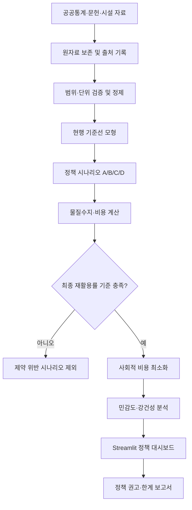

# 분리배출 정책의 사회적 비용 최소화 프로젝트 설계안

> **프로젝트명(가칭): Recycling Policy Lab**  
> **핵심 목표:** 최종 재활용률을 현행 수준 이상으로 유지한다는 제약 아래, 소비자·정부·생산자에게 발생하는 실질적인 사회적 비용을 최소화할 수 있는 분리배출·선별·생산자책임 정책을 탐색한다.  
> **형태:** 데이터 분석 + 정책 시뮬레이션 + 제약 최적화 + 웹 대시보드  
> **개발 환경:** Windows, VS Code, Python

---

## 1. 문제 정의와 연구 질문

### 1.1 문제의식

현재 분리배출제도는 소비자에게 품목별 분류, 이물질 제거, 세척 등의 행동을 요구한다. 이는 회수되는 자원의 품질을 높일 수 있지만 가계의 시간·물·에너지 비용을 수반한다. 반대로 분류 책임을 수거·선별시설로 옮기면 가계 부담을 줄일 수 있으나, 혼합 수거에 따른 오염과 선별시설 투자·운영비가 증가할 수 있다.

이 프로젝트는 '분리배출이 귀찮다'는 주장을 입증하려는 도구가 아니다. **동일하거나 더 높은 최종 재활용 성과를 달성하면서 사회 전체의 실물자원 소비를 줄일 수 있는 책임 분담 방식을 찾는 것**을 목표로 한다.

### 1.2 핵심 연구 질문

1. 현행 다품목 분리배출 방식의 가계·공공·생산자 비용은 각각 얼마인가?
2. 재활용품 혼합수거 및 공공 선별 강화로 전환할 때 비용은 누구에게 얼마나 이동하고, 총비용은 어떻게 바뀌는가?
3. **최종 재활용률이 현행 기준치 이상**이라는 조건을 만족하는 대안 중 사회적 비용을 최소화하는 조합은 무엇인가?
4. 선별시설 효율, 오염률, 소비자 투입 시간, 노동의 기회비용 및 투자비에 관한 불확실성 아래 결론이 유지되는가?
5. 재활용 용이성에 따라 EPR 분담금을 차등화하면 기업의 포장 설계 전환과 최종 재활용 성과에 어떤 영향을 미칠 수 있는가?

### 1.3 가설과 검증 원칙

- **H1:** 혼합 재활용 수거는 소비자 분류 시간을 줄일 수 있다.
- **H2:** 공공 선별시설의 효율이 충분하고 오염 손실이 제한적이면 전체 사회적 비용이 감소할 수 있다.
- **H3:** 반대로 혼합수거로 인한 품질 저하 또는 설비 투자비가 크면 현행 방식이 더 유리할 수 있다.
- **H4:** 생산자에게 재활용 용이성 개선 유인을 부여하면 일정 조건에서 선별·재처리 비용을 줄일 수 있다.

이들은 **검증할 가설**이다. 데이터 수집 전부터 정책 우위를 결론으로 설정하지 않는다.

---

## 2. 연구 범위 및 정책 시나리오

### 2.1 분석 범위

- **기본 분석:** 대한민국의 생활계폐기물 중 가정에서 배출하는 주요 재활용 가능 품목(종이·플라스틱·금속·유리 등)을 중심으로 시작한다.
- **확장:** 지역별 주거 유형, 수거 방식, 선별시설 규모 및 지자체별 시설·운영 조건을 추가한다.
- **제외·별도 관리:** 음식물쓰레기, 유해폐기물, 의료폐기물, 배터리 등은 별도의 처리 흐름으로 유지한다. 법적·안전상 혼합하면 안 되는 품목을 임의로 일반쓰레기와 섞는 모델을 정책 권고로 사용하지 않는다.
- **기간:** 연간 기준으로 통일한다. 투자비는 설비 수명과 할인율에 따라 연간화한다.

### 2.2 비교 정책

| 시나리오 | 소비자 배출 방식 | 공공 수거·선별 | 정책적 의미 |
|---|---|---|---|
| A. 현행 | 품목별 분리배출 | 현행 수거·선별 체계 | 기준선 |
| B. 혼합 재활용 | 일반·음식물·혼합 재활용 등 소수 분류 | 재활용품의 기계·인력 선별 강화 | **주요 정책 대안** |
| C. 혼합 일반폐기물 선별 | 일반폐기물과 일부 재활용품을 함께 배출하는 가상 대안 | 혼합폐기물 후단 선별 | 기술적·환경적 한계 검토용 **탐색 시나리오** |
| D. B + EPR 개선 | B와 동일 | B + 재활용 용이 포장 설계 확대 | 생산자 유인 결합 대안 |

**중요:** 미국의 single-stream recycling, 싱가포르의 commingled recycling은 통상 **재활용품끼리** 혼합 배출하는 방식이지, 일반폐기물과 모든 재활용품을 한꺼번에 섞는 제도가 아니다. 따라서 B와 C를 혼동하지 않는다.

---

## 3. 지표의 조작적 정의와 데이터 비교 가능성

### 3.1 주지표: 최종 재활용률

서로 다른 통계를 혼합하지 않도록, 프로젝트 내부의 최종 재활용률을 다음처럼 정의한다.

\[
r_p^{\mathrm{final}}=\frac{\sum_i R_{i,p}^{\mathrm{final}}}{\sum_i W_i}
\]

- \(W_i\): 동일한 발생원·기간·품목 범위에서의 폐기물 발생량(t/년)
- \(R_{i,p}^{\mathrm{final}}\): 최종적으로 사용 가능한 재생원료로 전환된 양(t/년)
- \(p\): 정책 시나리오

**공식 재활용률, 선별 회수율, 최종 재생원료 수율**은 분모·분자와 조사 범위가 다를 수 있다. 서로 다른 정의의 수치를 그대로 대조하지 않는다.

### 3.2 과정 지표

| 지표 | 정의 | 주의점 |
|---|---|---|
| 발생량 | 대상 품목 발생량(t/년) | 생활계/사업장/건설폐기물 구분 |
| 수거 회수율 | 발생량 대비 수거된 재활용 후보량 | 미수거·일반폐기물 혼입 구분 |
| 선별 회수율 | 선별시설 투입량 대비 적격 회수량 | 잔재물 제외 |
| 재생원료 전환 수율 | 회수량 대비 실제 재생원료 생산량 | 공정 손실 반영 |
| 오염률 | 투입물 중 재활용 부적격·오염물 비율 | 조사 기준을 명시 |
| 단위비용 | 원/톤, 원/가구·년 | 기준연도, 명목·실질가격 통일 |

### 3.3 사실 확인이 필요한 출발점

- '2018년 공식 재활용률 86.1% vs 실질 21%'라는 서술은 **원출처, 포함 폐기물 범위, 산정 방식**을 확인하기 전에는 실증적 결론으로 사용하지 않는다.
- '생활계폐기물 발생량 2019년 2,116만 t, 2024년 2,376만 t'은 원자료에서 재검증하고, 중간연도의 증감을 확인한다. 양 끝값의 증가가 매년 단조 증가를 뜻하지는 않는다.
- 헌법 제35조, 폐기물 관련 법령, EPR 제도의 구체적 적용 범위는 국가법령정보센터 및 한국환경공단 자료로 확인한다.
- 싱가포르·미국 사례는 도입 가능성의 참고 사례이지, 한국에서의 비용 우위를 입증하는 직접 근거가 아니다.

---

## 4. 수학적 모형

### 4.1 폐기물 물질수지

품목 \(i\), 정책 \(p\)에 대해

\[
R_{i,p}^{\mathrm{final}}=W_i\,c_{i,p}\,s_{i,p}\,y_{i,p}
\]

- \(c_{i,p}\in[0,1]\): 회수·수거 단계의 비율
- \(s_{i,p}\in[0,1]\): 선별 단계의 회수 비율
- \(y_{i,p}\in[0,1]\): 재생원료 전환 수율

단순 곱셈 모델에서 출발하되, 실제 구현에서는 오염률·품목별 혼입·설비 용량 등으로 \(s\), \(y\)가 바뀌도록 확장한다. 회수되지 않은 양 및 공정 잔재물은 최종 처분 흐름에 포함한다. 전체 입출력 물질수지 오차는 허용 범위 내여야 한다.

### 4.2 사회적 비용

\[
\min_{p,x}\; C_{\mathrm{social}}(p,x)
\]

\[
\begin{aligned}
C_{\mathrm{social}} = {}& C_{\mathrm{house}} + C_{\mathrm{collection}} + C_{\mathrm{sorting}}\\
&+C_{\mathrm{reprocessing}} + C_{\mathrm{disposal}}\\
&+C_{\mathrm{producer,real}}+C_{\mathrm{environment}}
\end{aligned}
\]

여기서 \(x\)는 시설 투자, 선별 효율, 수거 빈도, 생산자 포장재 선택 등 정책·운영 변수의 묶음이다.

- **가계 비용:** 분류·세척 노동시간의 기회비용, 물·전기 소비 등
- **수거비용:** 차량·연료·인력·운송거리·수거 빈도
- **선별비용:** 운영비와 **연간화한 설비 투자비**
- **재처리비용:** 재생원료 생산에 필요한 실물자원
- **잔재물 처리비용:** 소각·매립·기타 최종처리
- **생산자 실물비용:** 포장재 재설계, 소재 전환, 품질시험 등의 실제 추가자원
- **환경비용:** 중복 계산을 피한 온실가스·오염 등 외부비용(평가 가능할 때 포함)

**회계 원칙:** EPR 분담금, 세금 감면, 보조금은 이해당사자 간 이전지출이다. 사회적 비용에 동일 금액을 그대로 더하지 않는다. 징수·행정비용, 조세의 초과부담 등 실제 사회적 비용은 필요시 별도로 평가한다. 재생원료 판매 수입도 자원 편익과 시장가격의 중복계산 여부를 점검한다.

### 4.3 소비자의 시간 비용

\[
C_{\mathrm{time},p}=N\cdot t_p\cdot v
\]

- \(N\): 대상 가구 수
- \(t_p\): 가구당 연간 분리배출 관련 소요시간(시간/가구·년)
- \(v\): 시간의 기회비용(원/시간)

시간가치가 개인별로 다르므로 최소·기준·최대 범위로 민감도 분석한다. 모든 분리배출 시간을 사회 전체의 순손실이라고 단정하지 않으며 반사실적 대안을 명확히 한다.

### 4.4 핵심 제약조건

\[
\begin{aligned}
\text{minimize}\quad & C_{\mathrm{social}}(p,x)\\
\text{subject to}\quad & r_p^{\mathrm{final}}\ge r_A^{\mathrm{final}}\\
&\sum_i R_{i,p}^{\mathrm{final}}\ge R_{\min}\quad\text{(선택)}\\
&0\le c_{i,p},s_{i,p},y_{i,p}\le1\\
&Q_{f,p}\le K_{f,p}\quad\text{(시설 용량)}\\
&\text{물질수지, 안전 및 법규 제약 충족}
\end{aligned}
\]

- 비교 대상의 \(r_A^{\mathrm{final}}\)는 동일 연도·품목·발생원 범위의 기준선이다.
- 재활용률과 절대 재활용량은 다른 결과를 낼 수 있으므로, 범위 또는 총발생량 변화가 크면 양쪽을 함께 점검한다.
- 재활용률만 맞추고 환경피해가 커지는 대안을 피하도록, 온실가스 배출·최종처분량에 추가 제약을 거는 실험도 수행한다.
- 실제 재활용률 기준치 자체를 추정하지 못하는 초기 단계에서는 **가정 기반의 조건부 최적화**임을 명시한다.

### 4.5 재활용률과 사회적 비용 간 상충관계

기준선 외에도 목표 재활용률 \(r_{\mathrm{target}}\)를 여러 수준으로 바꿔서

\[
C^*(r)=\min_{p,x}\{C_{\mathrm{social}}(p,x):r_p^{\mathrm{final}}\ge r\}
\]

을 구한다. 이를 통해 '재활용률을 1%p 더 높이기 위해 얼마나 많은 사회적 비용이 추가되는가'를 그래프로 나타낸다. 가정과 품목에 따라 비선형적일 수 있다.

---

## 5. 불확실성 및 인과 추론의 한계

정책별 재활용 수율과 비용은 직접 관측되지 않을 수 있다. 따라서 다음의 증거 등급을 데이터마다 부여한다.

| 등급 | 의미 | 처리 |
|---|---|---|
| A | 공식 통계·행정 원자료로 직접 관측 | 기본 추정치 |
| B | 관련 실증연구·시설 운영보고서 | 출처와 외삽 조건 기재 |
| C | 설문·소규모 시간 관측 | 표본오차 명시 |
| D | 임의 가정·전문가 추정 | 결과에서 별도 표시, 민감도 필수 |

- **민감도 분석:** 가계 분류 시간, 선별 비용, 오염률, 회수율, 수율, 설비 수명, 할인율의 변동 범위를 탐색한다.
- **몬테카를로 분석:** 분포를 정당화할 근거가 있을 때만 분포를 설정하고 시뮬레이션한다. 임의로 만든 분포를 경험적 신뢰구간이라고 부르지 않는다.
- **강건성 검토:** 보수적·기준·낙관적 가정에서 동일한 정책이 추천되는지 확인한다.
- **인과 해석 제한:** 해외 제도와 국내 통계의 단순 비교만으로 제도 도입의 인과 효과를 주장하지 않는다. 향후 지역별 시범사업 및 전후·비교지역 자료가 확보되면 준실험적 평가를 검토한다.

---

## 6. 생산자책임재활용제도(EPR) 인센티브 모듈

### 6.1 정책 구상

기존 EPR 제도를 기반으로 포장재의 재활용 용이성에 따라 생산자의 분담금 또는 부담 구조를 차등화하는 대안을 모델링한다.

\[
F_i=F_{0,i}(1-d_i)
\]

- \(F_{0,i}\): 기본 분담금
- \(d_i\): 재활용 용이성에 따른 감면율(가산 부과인 경우 음수 허용)

### 6.2 기업의 선택 반응

기업이 친환경·재활용 용이 포장재로 바꾸는 추가 실물 비용과 예상 분담금 절감액을 비교하여 전환 가능성을 추정한다. 단순 버전에서는 전환 임계조건으로, 확장 버전에서는 기업별 비용 분포로 도입 비율을 산출한다.

- **입력:** 품목별 포장재 구성, 전환 비용, EPR 부담액, 감면율, 전환 후 선별·재처리 수율 변화
- **출력:** 기업 전환율(가정 기반), 최종 재활용량, 정부·기업의 재정 분담, 사회적 비용 변화
- **경계:** 현행 한국 EPR의 실제 적용 품목·평가등급·분담금 규칙을 확인하기 전에는 제도 설명과 새 정책의 시뮬레이션 규칙을 혼동하지 않는다.

---

## 7. 데이터 수집 및 가공 계획

### 7.1 데이터 목록

| 우선순위 | 데이터 | 주요 변수 | 후보 출처 |
|---|---|---|---|
| P0 | 연도별·종류별 폐기물 발생량 | 연도, 지역, 품목, 톤 | 환경부, KOSIS, 한국폐기물협회 |
| P0 | 재활용 및 처리 실적 | 수거량, 선별량, 재생원료량, 잔재물 | 환경부, 지자체, 시설 보고서 |
| P0 | 품목 및 시설 범위 정의 | 조사대상, 발생원, 분모, 처리단계 | 각 통계 메타데이터 |
| P1 | 가정 분리배출 시간 | 시간/가구·주, 주거유형 | 문헌, 자체 설문·실측 |
| P1 | 수거·선별 운영비 | 인건비, 전력비, 운송비, 처리량 | 지자체 예산·결산, 위탁운영 자료 |
| P1 | 시설 투자·용량 | 투자비, 연간 처리량, 수명 | 지자체 시설 자료, 사업 타당성 보고서 |
| P1 | 품목별 손실·오염률 | 유입 오염률, 선별 회수율, 수율 | 관련 논문, 시설 실증 연구 |
| P2 | 기업 포장재 전환비용 | 원/단위, 전환후 재활용성 | 기업 공시·연구 자료 |
| P2 | 탄소·환경 영향 계수 | kgCO₂e/t, 오염·처리 영향 | 환경성적·LCA 연구 |

### 7.2 데이터 원칙

1. 모든 테이블에 `source_url`, `source_title`, `retrieved_at`, `reference_year`, `geography`, `waste_scope`, `unit`, `evidence_grade`를 기록한다.
2. 화폐는 원/기준연도로 맞추고, 수량은 t/년, 시간은 시간/가구·년으로 정규화한다.
3. 출처 불명 수치나 검증되지 않은 추정치는 원자료 테이블에 **확정 데이터로 기입하지 않는다**.
4. 누락값을 0으로 자동 변환하지 않는다. 결측 여부와 대체값·보간 여부를 별도 기록한다.
5. 데이터 처리 단계마다 원본 파일을 보존하고 변환 코드를 버전 관리한다.

### 7.3 참고 경로(탐색 출발점, 상세 자료 존재 여부는 별도 확인)

- 한국폐기물협회: https://www.kwaste.or.kr/
- 국가통계포털 KOSIS: https://kosis.kr/
- 공공데이터포털: https://www.data.go.kr/
- 국가법령정보센터: https://www.law.go.kr/
- 한국환경공단: https://www.keco.or.kr/
- 싱가포르 국가환경청 NEA: https://www.nea.gov.sg/
- 미국 환경보호청 EPA: https://www.epa.gov/recycle

---

## 8. 기술 아키텍처

### 8.1 권장 기술 스택

- Python 3.11+
- pandas, NumPy: 수집 데이터 가공 및 벡터화 계산
- SciPy: 연속 변수 최적화, 민감도 분석
- PuLP 또는 scipy.optimize.milp: 시설 선택 등 이산 결정변수가 있을 때
- Plotly, Streamlit: 인터랙티브 대시보드
- PyYAML: 시나리오 설정
- pytest: 재현성과 검증
- Jupyter: 탐색적 데이터 분석
- (선택) SALib: 체계적인 민감도 분석

### 8.2 저장소 구조

```text
recycling-policy-lab/
├── README.md
├── pyproject.toml
├── requirements.txt
├── .gitignore
├── configs/
│   ├── baseline.yaml
│   ├── scenario_a.yaml
│   ├── scenario_b.yaml
│   ├── scenario_c.yaml
│   └── scenario_d.yaml
├── data/
│   ├── raw/
│   ├── interim/
│   ├── processed/
│   └── sources.csv
├── notebooks/
│   ├── 01_waste_trends.ipynb
│   └── 02_data_quality.ipynb
├── src/
│   ├── ingest.py
│   ├── validate.py
│   ├── preprocess.py
│   ├── mass_balance.py
│   ├── cost_model.py
│   ├── scenarios.py
│   ├── optimize.py
│   ├── sensitivity.py
│   └── epr.py
├── tests/
│   ├── test_mass_balance.py
│   ├── test_cost_model.py
│   ├── test_constraints.py
│   └── test_reproducibility.py
├── app.py
├── outputs/
│   ├── figures/
│   ├── tables/
│   └── scenario_runs/
└── docs/
    ├── data_dictionary.md
    ├── assumptions.md
    └── methodology.md
```

### 8.3 데이터 흐름



---

## 9. 최적화 구현 전략

### 9.1 1단계: 설명 가능한 계산 모델

- 각 시나리오의 매개변수를 YAML 파일로 저장한다.
- 품목별 수거·선별·재생원료 전환 단계를 계산한다.
- 총사회적 비용 및 이해당사자별 비용 부담을 병렬로 출력한다.
- 법정·안전 예외품목을 별도 처리한다.
- 예제 데이터는 **합성 데이터**임을 명확히 표시한다.

### 9.2 2단계: 제약 최적화

예시 결정변수:

- \(x_1\): 혼합 재활용으로 전환하는 대상 지역 또는 품목의 비율
- \(x_2\): 기계 선별설비 투자 수준
- \(x_3\): 수거 주기 또는 물류 최적화 수준
- \(x_4\): 재활용 용이 포장재 전환율

목적함수는 연간 사회적 비용을 최소화하며, 현행 대비 최종 재활용률을 저하시키지 않고 시설 용량 및 예산·안전 규제를 만족한다. 정책 전환이 분리배출 행동·오염률에 미치는 영향을 데이터로 알 수 없을 때는 **외생 시나리오 가정**으로 처리하고 추정된 인과효과라고 표현하지 않는다.

### 9.3 3단계: 다중 기준 분석

단일 최적해만 제시하지 않고 정책별 다음을 비교한다.

- 최종 재활용률(%), 최종 재생원료량(t/년)
- 총사회적 비용(원/년), 기준선 대비 절감액과 변화율
- 가계 분리배출 시간(시간/가구·년)
- 공공 예산 소요, 기업 실물비용 및 분담금 변화
- 온실가스 배출량 및 최종 처분량(가능한 경우)
- 결론의 불확실성과 가정 민감도

---

## 10. 대시보드 요구사항

### 10.1 화면 구성

1. **현황 분석:** 연도별 발생량·품목별 처리현황·통계 정의 차이
2. **정책 비교:** A/B/C/D 시나리오별 결과표, 비용 분담의 변화
3. **최적화 실험:** 최소 재활용률, 시설 용량, 세척 시간, 회수율 등 설정
4. **민감도 분석:** 핵심 변수별 결과 변화, 보수·기준·낙관적 가정 비교
5. **EPR 인센티브:** 분담금 차등 수준과 기업 전환에 대한 가상 모델
6. **근거 확인:** 출처·연도·증거등급·가정·모델 버전 표시

### 10.2 필수 시각화

- 폐기물 발생량 추세선
- 품목별 물질수지 흐름도(Sankey diagram)
- 정책별 사회적 비용 누적 막대그래프
- 최종 재활용률과 비용의 산점도/효율적 경계
- 재활용률 목표치에 따른 최적 비용 곡선
- 가정 변화에 따른 민감도 그래프

**인터페이스 안내:** 사용자가 임의로 움직이는 슬라이더 값은 '가정값'으로, 관측 기반 추정치는 '자료 기반 값'으로 시각적으로 구분한다.

---

## 11. 개발 단계 및 산출물

| 단계 | 목표 | 구체적 작업 | 완료 기준 |
|---|---|---|---|
| M0. 정의 | 모형의 범위 확정 | 품목, 발생원, 최종 재활용률 정의, 법·안전 예외 | 데이터 사전·방법론 초안 |
| M1. 데이터 | 기준선 구축 | 공식 통계 확보, 출처 기록, 단위 정규화 | 재현 가능한 추세표와 품목별 데이터 |
| M2. 시뮬레이터 | A/B/C 계산 구현 | 물질수지, 가계·공공·생산자 비용 | 합성 입력으로 일관된 결과 및 테스트 통과 |
| M3. 최적화 | 재활용률 제약 반영 | 제약 충족 대안 필터링, 비용 최소화 | 재활용률 미달안이 최적해로 선택되지 않음 |
| M4. 강건성 | 불확실성 공개 | 민감도·시나리오 분석 | 주요 결론의 조건과 실패 조건 제시 |
| M5. EPR | 기업 유인 결합 | 분담금 차등·전환비용 가정 | 정책별 비용 분담과 실물비용 구분 |
| M6. 시각화 | 대시보드·보고서 | Streamlit, 출처/가정 표시, 결과 내보내기 | 동일 입력의 결과 재현 가능 |

### 11.1 최소기능제품(MVP)

**반드시 구현할 기능**

- 3개 이상 정책 시나리오 비교
- 4개 이상 재활용 가능 품목의 물질수지
- 소비자·공공·생산자의 비용 분해
- 현행 최종 재활용률 이상의 시나리오만 선택하는 최적화
- 불확실한 핵심 매개변수 3개 이상의 민감도 분석
- 모든 입력 수치의 출처 또는 '합성·가정' 표시
- 결과 CSV 저장 및 간단한 Streamlit 화면

**후순위 기능**

- 지역별 공간 분석, 시설 입지 최적화
- 설문 데이터 자동 수집
- 기업별 EPR 제도 시뮬레이션
- 탄소 LCA 정교화 및 정책 시범사업 효과 평가

---

## 12. 테스트와 분석 품질 기준

### 12.1 단위 테스트

1. 모든 회수율·선별률·수율이 0~1 범위에 있어야 한다.
2. 최종 재생원료량이 최초 발생량보다 커지지 않아야 한다.
3. 폐기물 물질수지의 유입량과 산출량·손실량이 일치해야 한다.
4. 동일 입력·난수 시드에서 동일 결과가 재현되어야 한다.
5. 제약조건 미충족 대안은 최적 정책으로 표시되지 않아야 한다.
6. EPR 분담금 등 이전지출은 사회적 자원 비용에 중복 반영되지 않아야 한다.
7. 결측값 또는 단위 불일치가 조용히 무시되지 않고 오류 또는 경고로 드러나야 한다.

### 12.2 결과 해석 기준

- **가능한 결론:** '가정 X·Y·Z와 관측 자료 범위에서 B가 A보다 사회적 비용이 낮고 최종 재활용률도 유지된다.'
- **불가능한 결론:** '해외에서 B를 시행하므로 한국에서도 반드시 저렴하다.'
- **불가능한 결론:** '서로 다른 모집단의 공식 재활용률과 실질 재활용률 차이가 곧 폐기물 정책의 실패 규모다.'

---

## 13. 정책 제안으로 연결하는 방법

연구 결과를 바탕으로 다음의 정책 패키지를 비교한다.

1. **수거 방식 간소화:** 혼합 재활용 수거를 일부 지역에서 시범 도입하되 음식물·유해물질과 분리한다.
2. **공공 선별시설 고도화:** 회수율·오염률에 대한 실적 지표를 설정하고 설비 효율을 평가한다.
3. **생산자책임 강화:** 재활용이 쉬운 포장 설계를 유도하도록 EPR 분담금 차등 수준을 조정한다.
4. **성과 공개 개선:** 단순 수거·재활용 처리량뿐 아니라 최종 재생원료 생산량과 잔재물 비율을 함께 공개하도록 제안한다.
5. **실증 시범사업:** 비교가능한 지역에서 분리배출 시간·선별비·최종 재활용량을 동일 기준으로 측정한다.

정책 권고문에는 **어떤 조건에서 권고가 성립하는지**, **어떤 조건에서는 현행 방식이 더 나은지**, **추가로 필요한 데이터가 무엇인지**를 명시한다.

---

## 14. 연구의 최종 산출물

- 재현 가능한 분석 코드와 데이터 출처 목록
- 데이터 사전 및 수학적 모형 설명서
- 시나리오별 비용·재활용 성과 비교표
- 제약 최적화 결과와 민감도 분석
- 인터랙티브 정책 대시보드
- 정책 제안 보고서(근거·한계·시범사업 제안 포함)

### 최종 연구 명제

> **'분리배출 책임을 누구에게 얼마나 배분해야, 최종 재활용 성과를 낮추지 않으면서 사회 전체의 비용을 가장 적게 쓸 수 있는가?'**

분석은 특정 정책의 승리를 전제하지 않는다. 소비자 부담을 줄이는 정책이 실제로 더 친환경적이고 경제적인지는, 수거 과정의 오염과 공공 선별 효율, 생산자의 제품 설계, 가계의 시간 비용을 함께 고려해 검증한다.

---

## 부록 A. Codex 개발 시작용 작업 지시

```text
프로젝트: Recycling Policy Lab
환경: Windows + VS Code + Python 3.11+

목표:
  동일한 폐기물 범위의 최종 재활용률을 현행 시나리오 A 이상으로 유지하면서
  사회적 실물자원 비용을 최소화하는 정책 시나리오 비교 MVP를 구현한다.

구현 순서:
  1. 위 설계안의 저장소 구조 생성
  2. synthetic/sample 데이터를 실제 통계와 혼동하지 않게 구성
  3. 품목별 수거·선별·재생원료 전환 물질수지 계산
  4. 가계·수거·선별·재처리·처분·생산자 비용 계산
  5. 시나리오 A, B, C 입력값을 YAML 파일로 구성
  6. 재활용률 제약을 만족하는 최소비용 시나리오 탐색
  7. 주요 파라미터에 대한 민감도 분석
  8. Streamlit 화면 및 CSV 내보내기 구현
  9. pytest로 물질수지·제약조건·비용 중복계산 검증
 10. README, 가정 문서, 데이터 출처 템플릿 작성

필수 원칙:
  - 미확인 통계를 사실로 기입하지 말 것
  - 공식 재활용률과 최종 재활용률을 구분할 것
  - 환경비용과 금전적 이전지출을 혼동하지 말 것
  - 합성 데이터는 항상 합성 데이터로 표시할 것
  - 출처·단위·연도·대상 범위를 기록할 것
  - 먼저 작동하는 단순 모델을 구현하고 이후 실제 데이터로 교체할 것
```
